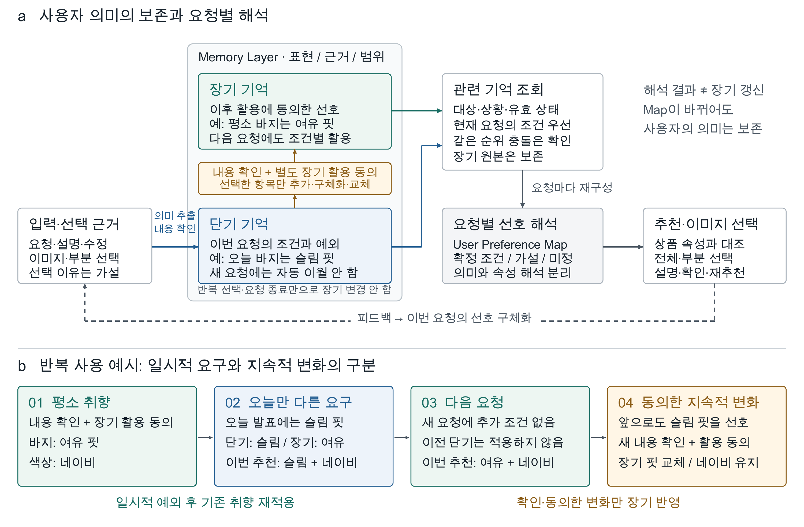

# System Design: 장·단기 의미 기억의 구성과 사용자 확인에 따른 점진적 갱신

> 중간보고서 삽입용 원고 · 2026-10-15 개정. 기억 스키마, 생성·조회·갱신 절차, LLM과 코드의 역할을 현재 구현에 맞춰 설명한다. ‘보고서 본문’과 그림 캡션은 제출용이며, 마지막 ‘작성 근거와 구현 범위’는 작성자를 위한 메모다. 예시의 사용자·대화·ID는 모두 가상이다.

## 보고서 본문

### 1. 취향을 항목별로 수정할 수 있는 기억 구조

LUMI는 반복 상호작용에서 사용자의 취향을 파악하기 위해, 사용자 전체를 하나의 스타일로 요약하는 대신 **대상과 상황이 명시된 선호 항목을 만들고, 사용자 피드백에 따라 필요한 항목을 추가하거나 수정하는 구조**를 사용한다. 예를 들어 ‘네이비 색상을 좋아하고, 상의는 여유핏이 좋지만 바지는 슬림핏이 좋다’는 설명은 색상, 상의 핏, 바지 핏의 서로 다른 기억 항목으로 나눈다. 이후 바지 선호가 바뀌더라도 색상과 상의 선호를 함께 재작성할 필요가 없도록 하기 위해서다.

시스템은 세 종류의 표현을 구분한다. 첫째는 SQLite에 저장하는 사용자 의미 기억으로, 장기 기억과 현재 요청의 단기 기억이 같은 스키마를 사용한다. 둘째는 현재 세션에서 얻은 이미지 선택, 선택 이유의 가설과 확인된 반응이다. 셋째는 저장된 기억을 현재 요청에 맞춰 해석한 User Preference Map이다. 이 구분에 따라 상품을 선택한 사실, 그 선택 이유에 대한 모델의 해석, 이후에도 활용하기로 확인된 사용자 선호가 동일한 데이터로 취급되지 않는다.

### 2. 메모리 스키마: 내용뿐 아니라 대상·근거·갱신 경계를 저장한다

표 1은 기억 항목의 주요 필드다. 장기와 단기는 별도의 데이터 구조가 아니라 `scope`와 `request_id`로 적용 범위를 달리하는 동일한 기억 항목이다. 단기 항목은 특정 요청 ID에 연결되고, 장기 항목은 요청 ID 없이 사용자에게 연결된다. 각 항목의 내용과 적용 범위를 함께 저장하므로, 새로운 입력이 무엇을 보완하거나 변경하는지 항목 수준에서 검토할 수 있다.

**표 1. LUMI 기억 항목의 주요 스키마.** 필드명은 애플리케이션에서 사용하는 표현이며, 원문 근거·대상·조건은 SQLite에 JSON 형태로 저장된다.

| 필드 | 저장하는 내용 | 생성·활용·갱신에서의 역할 |
|---|---|---|
| `content`, `topic` | 최소 사용자 의미와 분류 주제 | `content`는 ‘평소 바지는 여유핏을 선호한다’ 같은 문장이다. `topic=fit`은 분류용이며 취향의 확정값이 아니다. |
| `evidence` | 근거 종류, 최소 원문 인용, 입력·선택 참조 | 사용자 발화, 이미지 선택, 확인 응답 중 무엇이 해당 기억의 근거인지 연결한다. |
| `selector` | 아이템 종류 또는 이번 요청의 대상 | 바지에 관한 선호를 셔츠에 적용하지 않는다. 요청 전용 대상은 그대로 장기화할 수 없다. |
| `conditions` | 적용할 상황·활동·목표 | 예: `occasion=미팅`. 현재 상황이 확인되어 일치할 때만 항목을 적용한다. |
| `polarity`, `strength`, `match` | 선호·회피·요구, 적용 강도, 복수 조건의 관계 | 무엇을 좋아하거나 피하는지와 후보를 제한할 정도의 요구인지를 구분한다. 복수 값의 ‘하나면 됨/모두 필요/범위’도 유지한다. |
| `scope`, `request_id` | 장기 또는 단기, 연결된 요청 | `short_term`은 해당 요청에서만, `long_term`은 이후 관련 요청에서도 조회한다. |
| `origin`, `confirmed`, `status` | 출처, 내용 확인, 활성 상태 | 미확인 후보와 확인된 활성 항목을 구분한다. 철회·대체된 항목은 추천에서 제외한다. |
| `evidence_ref`, `consent_ref` | 내용 확인과 이후 활용 동의의 참조 | 내용 확인만으로 장기화하지 않는다. 장기 생성·승격·교체에는 별도 동의가 필요하다. |
| `id`, `family_id`, `version` | 항목 식별자, 승격·교체의 연결, 변경 버전 | 어떤 항목을 바꿀지 식별하고, 같은 기억의 단기·장기 사본을 중복 적용하지 않으며, 오래된 갱신 요청을 거부한다. |
| `valid_from`, `valid_until`, `retention_until` | 적용 가능 기간과 보관 기한 | 범위에 맞는 내용이어도 만료되면 다시 활용하지 않는다. 적용 종료와 기록 삭제는 구분한다. |

다음은 사용자가 ‘평소 바지는 여유핏을 좋아해’라는 내용을 확인한 뒤 만들어지는 단기 기억의 일부 필드다. ID는 설명을 위해 축약했으며, 시간과 내부 관리 필드는 생략했다.

```json
{
  "id": "S1",
  "family_id": "F1",
  "version": 1,
  "request_id": "R1",
  "scope": "short_term",
  "topic": "fit",
  "content": "평소 바지는 여유핏을 좋아한다",
  "selector": {"garment_type": "Pants"},
  "conditions": {},
  "polarity": "prefer",
  "strength": "soft",
  "feature": null,
  "values": [],
  "origin": "explicit",
  "confirmed": true,
  "status": "active",
  "evidence": [{
    "kind": "user_text",
    "quote": "평소 바지는 여유핏을 좋아해",
    "source_ref": "input-R1"
  }],
  "evidence_ref": "review-R1",
  "consent_ref": null
}
```

여기서 저장된 것은 `fit=Relaxed`라는 속성값이 아니라 사용자의 의미와 근거다. 새 의미 기억은 `feature=null`, `values=[]`로 저장할 수 있다. 따라서 ‘디자이너적인 요소가 좋다’처럼 상품 속성으로 아직 번역되지 않은 취향도 사라지지 않는다. 명확한 ‘여유핏’은 추천 시점에 속성값으로 해석하되, 모호한 표현을 기억하기 위해 임의의 스타일 라벨을 선택하지 않는다.

### 3. 입력에서 기억을 구성하는 과정

사용자 입력이 들어오면 LLM은 최신 발화에서 필요한 선호를 추출하고, 대상·주제·최소 의미·원문 인용·상황 조건을 가진 기억 후보를 제안한다. ‘그 바지’와 같은 지시어는 제공된 대화 맥락에서 풀어 쓰지만, 근거 인용은 실제 입력과 일치해야 한다. 코드가 출력 형식, 허용된 값, 원문 인용의 존재, 교체 대상으로 지목한 항목의 요청·대상을 검사한 뒤 사용자에게 후보를 보여준다. 이 검사는 형식과 출처의 유효성을 확인하며, 모델이 의미를 정확히 이해했다는 보장은 아니므로 내용 확인을 별도로 거친다.

현재 연구 화면에서는 사용자가 이번 요청에 적용할 후보를 확인하면 코드가 선택된 항목만 활성 단기 기억으로 생성한다. 확인되지 않은 후보는 유효 기억으로 조회하지 않는다. 저장 계층은 미확인 `candidate`를 기록한 뒤 `confirm`으로 활성화하는 경로도 지원하지만, 연구 화면의 요청 검토 후보는 확인 전까지 화면 상태로 유지된다. 두 경로 모두 **모델의 출력만으로 확인된 기억이 만들어지지 않는다**는 원칙을 따른다.

장기 여부는 이 단계에서 결정하지 않는다. 모델이 ‘평소’라는 표현에서 지속적 선호의 가능성을 제안해도, 이는 `scope_hint`이며 장기 저장의 허가가 아니다. 앞의 `S1`을 이후에도 활용하기로 사용자가 동의하면 코드가 `promote`를 실행한다. 이때 기존 단기 행의 `scope`만 바꾸는 대신, 원래 의미·근거·대상·조건과 같은 `family_id=F1`을 가진 새 장기 항목 `L1`을 만든다. `L1`은 `request_id=null`, `scope=long_term`이며 새 `consent_ref`를 갖는다. 원래 요청의 확인과 미래 활용의 동의를 별도로 추적하면서, 추천에는 같은 가족의 내용을 한 번만 적용한다.

요구의 강도도 입력에서 제안하고 확인하는 정보다. 현재 모델 프롬프트와 오프라인 규칙은 ‘꼭/반드시/제외’와 일반적인 선호 표현을 구분해 `polarity`와 `strength`를 제안하며, 화면에는 ‘필수·선호·제외’로 표시한다. 예를 들어 명시적인 큰 로고 제외는 후보 제한에, 일반적인 네이비 선호는 순위에 사용한다. 다만 모호한 ‘별로다’를 완전한 제외로 볼지 약한 비선호로 볼지를 정확히 판단하는 기능은 검증되지 않았고, 강도만을 별도로 확인하는 전용 상호작용도 아직 구현되지 않았다. 본 설계의 핵심은 이 분류가 사용자 확인을 대신하지 않으며, 장·단기 범위와도 독립적이라는 점이다.

### 4. 조회한 기억을 현재 추천 조건으로 바꾸는 과정

추천 시점에는 코드가 먼저 현재 사용자와 요청의 기억을 조회하고, 활성·확인 상태, 기간, 아이템 대상과 상황 조건을 검사한다. 예를 들어 `selector=Pants`인 항목은 바지에만 적용되고, `conditions={occasion: 미팅}`인 항목은 현재 요청에서 미팅이라는 상황이 확인되어야 적용된다. 단기 항목은 현재 `request_id`와 일치해야 하므로, 앞선 요청의 요구가 다음 요청에 따라오는 것을 저장·조회 단계에서 제한한다.

선별된 기억 중 명확한 핏·색상 표현은 코드의 제한된 표현 사전을 통해 임시 속성 조건으로 변환한다. 예를 들어 `S1`의 문장은 바지의 `fit=Relaxed` 조건이 되지만, 저장된 `S1.content`나 `S1.feature`를 변경하지 않는다. 나머지 의미는 관련 기억 ID와 적용 가능한 대상과 함께 읽기 전용 LLM에 전달한다. 모델은 해당 근거로 추천 속성이나 확인 질문을 제안할 수 있고, 코드는 속성의 허용값·대상·근거 참조를 검증한다. 모델 제안은 추론 상태로 표시되며 사용자가 확인한 조건을 덮어쓰거나 장기 기억으로 저장할 수 없다.

명확한 속성으로 해석된 기억이 충돌할 때에는 코드가 현재 요청의 명시적인 단기 조건을 충돌하는 장기 조건보다 우선 적용한다. 평소 바지는 여유핏이라는 `L1`과 오늘은 슬림핏이 필요하다는 `S2`가 있다면, 이번 바지의 실행 조건은 `Slim`이 되고 `L1`은 이번 요청의 해당 속성 적용에서 제외된다. **장기 기억의 행이나 내용은 바뀌지 않는다.** 서로 양립하는 색상 선호 등은 함께 적용한다. 같은 우선순위의 상충 조건은 임의로 하나를 고르지 않고 충돌 상태와 확인 근거를 남긴다. 이 처리는 해석된 속성 조건에 대한 규칙이며, 모든 자유 문장의 의미적 모순을 자동 판별하는 기능을 뜻하지 않는다.

최종 User Preference Map에는 지정된 조건, 추론 제안, 미정, 비적용, 충돌 상태와 해당 근거가 포함된다. 사용자가 반드시 원한다고 한 내용의 의미가 불분명하면 먼저 확인한다. 그 내용을 이해한 것처럼 처리하거나 추천에서 임의로 제외하지 않는다. 상품 자체의 Product Feature Map은 이 사용자 선호 표현과 별도로 대조한다.

### 5. 새로운 피드백이 어떤 상태와 항목을 바꾸는가

이미지 선택 뒤에는 선택한 룩 또는 특정 아이템을 가리키는 이벤트를 세션에 기록한다. LLM은 이벤트와 제시된 상품 속성을 근거로 ‘바지의 슬림한 핏이 좋아서 선택했을 수 있다’와 같은 가설을 제안한다. 가설은 대상, 속성, 값, 근거 이벤트 ID와 이유를 가지지만 영속 기억에 곧바로 기록되지 않는다. 미선택도 비선호 항목으로 저장하지 않는다.

현재 연구 구현에서는 선택 근거, 잠정 가설, 사용자가 확인한 이유를 세션 상태의 `evidence`, `hypotheses`, `confirmed`로 관리한다. 사용자가 이유를 확인하면 해당 대상·속성의 확인된 세션 신호를 갱신하고 재추천에 사용한다. 이 신호는 저장 기억으로 만든 Map과 별도로 추천기에 전달되므로, ‘맞아요’라는 한 번의 응답이 장기 프로필 전체를 다시 쓰는 동작은 아니다. 종료 후 장기 저장을 선택할 때 비로소 확인한 이유를 의미 문장과 선택·응답 근거로 구성하여 저장한다.

**표 2. 입력·피드백별 기억 갱신.** 갱신은 해당 항목과 적용 범위에 한정하며, 무관한 취향은 유지한다.

| 발생한 경우 | 바꾸는 데이터와 실행 동작 | 보존하는 데이터 |
|---|---|---|
| 새로운 선호를 표현하고 이번 요청 적용을 확인 | `create`: 대상·주제·근거를 가진 활성 단기 항목 생성 | 다른 아이템·속성의 기존 기억 |
| 같은 요청에서 설명을 정정 | 연구 화면의 재검토 후 이전 단기 항목 `withdraw`와 새 의미의 `create`를 한 번에 처리 | 요청 ID와 이전 항목의 제한된 기록. 장기 기억은 자동 수정하지 않음 |
| 평소 취향과 다른 이번 요구를 확인 | 현재 요청의 단기 항목 생성; 충돌하는 장기 속성은 이번 조회 결과에서만 억제 | 기존 장기 항목의 내용·동의·상태 |
| 이미지 선택만 제공 | 세션 선택 이벤트와 잠정 이유 가설 갱신 | 확인된 의미 기억과 장기 기억 |
| 이미지 선택의 이유를 확인 | 확인된 세션 신호 갱신; 재추천에 반영 | 장기 기억은 저장 동의 전까지 불변 |
| 확인된 단기 표현의 이후 활용에 동의 | `promote`: 새 장기 ID와 동의 참조를 생성하고 같은 기억 가족으로 연결 | 사용자 의미·원문 근거·대상·상황 조건 |
| 기존 취향을 이후에도 바꾸기로 확인·동의 | `replace`: 새 장기 항목 생성, 이전 항목은 `superseded`로 변경 | 충돌하지 않는 다른 기억; 새 항목에 변경 근거 연결 |
| 활용을 철회하거나 기록 삭제 | `withdraw`는 조회에서 제외, `delete`는 연결된 기억 가족의 기록 삭제 | 철회·삭제된 내용을 이전 요약으로 자동 복구하지 않음 |

`replace`는 기존 항목의 문장을 조용히 수정하는 연산이 아니다. 새 의미는 새 ID와 `version=1`로 생성하고, 이전 항목은 `status=superseded`로 바꾸면서 버전을 증가시킨다. 이때 같은 `family_id`를 사용하고 장기 교체에는 새 동의를 요구한다. 결과적으로 ‘무엇을 좋아한다고 이해했는지’와 ‘어떤 확인을 통해 바뀌었는지’를 구분할 수 있다. 버전 검사는 이미 바뀐 기억을 오래된 요청이 다시 수정하는 것을 막는다. 관련 갱신은 SQLite 트랜잭션으로 처리해 일부만 적용된 상태를 남기지 않는다.

### 6. 반복 사용에서 취향이 구체화되는 예시

그림 1b의 사용 흐름을 실제 저장 상태에 대응시키면 다음과 같다. 아래 예시는 실행 가능한 기억 연산의 관계를 설명하기 위한 가상 사례이며, 연구 효과를 측정한 결과가 아니다.

1. **초기 취향을 구성한다.** ‘평소 바지는 여유핏, 색상은 네이비가 좋다’를 바지 핏과 색상의 두 단기 항목으로 나눈다. 내용 확인과 이후 활용 동의를 거쳐 장기 항목 `L1`과 `LC`를 구성한다. 둘은 독립된 기억이므로 각각 수정할 수 있다.
2. **일시적 예외를 반영한다.** 다음 요청 `R2`에서 ‘오늘 발표에는 바지가 꼭 슬림핏이어야 한다’를 확인하면 `S2`를 생성한다. `S2`는 `scope=short_term`, `request_id=R2`, `topic=fit`, `polarity=require`, `strength=hard`이며 내용과 입력 근거를 보존한다. 이번 바지 조건은 `Slim`의 근거 `S2`와 `Navy`의 근거 `LC`로 구성된다. `L1`은 삭제·교체되지 않는다.
3. **다음 요청에서 기존 선호를 다시 적용한다.** 새 요청 `R3`에는 `S2`의 요청 ID가 맞지 않아 조회 결과에서 빠진다. 별도 핏 요구가 없으면 `L1`과 `LC`를 통해 다시 `Relaxed`와 `Navy`를 적용한다. 일시적 요구의 분리는 모델이 과거 문장을 잘 잊기를 기대하는 방식이 아니라 요청 경계 검사로 수행한다.
4. **새로운 선호의 이유를 구체화한다.** 사용자가 슬림한 바지를 선택한 뒤 핏이 마음에 들었다고 확인하면, 현재 세션에는 바지·핏·슬림을 연결한 확인 신호가 생긴다. 선택한 룩의 모든 속성을 좋아한다고 확대하지 않고, 확인한 바지 핏만 이후 활용 후보로 제시한다.
5. **이후 활용할 변화만 장기에 반영한다.** 저장 화면에서 사용자가 기존 여유핏 선호를 대체할 내용을 확인하고 동의하면 `replace(L1)`으로 새 장기 항목 `L2`를 만들고 `L1`은 대체된 상태로 전환한다. `LC`는 그대로 남는다. 다음 요청부터는 바지 핏에 `L2`를 적용한다. 저장을 선택하지 않았다면 이 변화는 해당 세션에 머문다.

더 추상적인 표현도 같은 방식으로 구체화한다. ‘디자이너적인 요소가 좋다’는 기억은 처음에는 원문 의미와 근거만 가진다. 이후 ‘로고보다 소재의 질감이 좋았다’는 설명이나 부분 선택을 얻으면, LLM은 어떤 요소와 대상을 의미하는지 후보를 제안하고 사용자가 확인한 새 의미를 해당 범위의 항목으로 기록한다. 기존 표현을 정정하려면 정정 대상과 새 내용을 확인하고, 장기 내용의 변경에는 다시 동의를 받는다. 이때 단순히 ‘Chic’이라는 값을 채우는 대신 **막연한 표현 → 대상과 이유의 확인 → 구체적 선호 항목 → 요청별 속성 해석**으로 취향을 구체화한다. 현재 속성 사전으로 표현하지 못하는 의미는 기억으로 남기되, 추천에 완전히 반영된 것으로 간주하지 않는다.

### 7. LLM과 코드의 역할 분담

LLM은 자유로운 언어와 선택 이유를 해석하지만 기억 저장의 권한은 갖지 않는다. 모델이 제안한 의미를 실제로 확인할 책임은 사용자에게, 확인·동의와 현재 상태에 따라 연산을 허용할 책임은 코드에 둔다. 표 3은 이 역할을 단계별로 보여준다.

**표 3. 의미 해석과 기억 관리의 역할 분담.**

| 단계 | LLM이 제안하는 것 | 코드와 사용자 확인이 결정하는 것 |
|---|---|---|
| 발화에서 후보 추출 | 최소 의미, 주제, 대상, 강도·범위의 힌트, 명시된 상황 조건 | 원문 인용·형식·교체 대상 검증; 사용자가 확인한 항목만 단기 적용 |
| 현재 기억 조회 | 조회 후 전달받은 의미를 해석 | 사용자·요청·대상·상황·기간·확인 상태의 필터링, 기억 가족의 중복 제거 |
| 추천 속성 구성 | 모호한 의미의 약한 속성 제안과 질문 | 명확한 표현의 직접 변환, 허용값·대상·근거 검증, 명시 조건 보존, 속성 상충 처리 |
| 이미지 선택 해석 | 선택 이유의 잠정 가설 | 실제 선택 이벤트 기록; 확인된 이유만 세션 신호로 반영; 미선택을 회피로 바꾸지 않음 |
| 장기 갱신 | 별도의 저장 판단을 하지 않음. 앞 단계에서 추출·확인한 의미와 선택 이유를 사용 | 코드가 저장 후보와 대체 대상을 구성; 사용자가 내용·범위와 이후 활용을 확인한 뒤 기억 연산 실행 |

모델의 의미 이해가 불완전하더라도 근거 없는 장기 쓰기를 허용하지 않는 것이 이 분담의 목적이다. 또한 추론이 끝난 뒤 코드가 현재 기억 상태를 다시 검사한다. 모델 호출 중 기억이 수정·철회되거나 요청이 종료되었다면 오래된 결과를 버리고 다시 구성한다. 따라서 한 번의 모델 출력이 사용자 확인 이후의 최신 상태를 되돌릴 수 없다.

현재 프로토타입은 모델을 사용하는 모드와 제한된 사전·규칙을 사용하는 오프라인 모드를 구분한다. 오프라인 실행은 위 저장·조회·갱신 경로를 확인하는 데 사용하며, 일반적인 자연어 의미 해석이나 실제 사용자의 취향 이해 성능을 검증한 것으로 보지 않는다.

### 8. RQ1에서 말하는 점진적 취향 재현

LUMI에서 ‘취향에 점점 가까워진다’는 목표는 반복 횟수에 따라 취향 벡터의 가중치를 자동으로 높이는 학습을 뜻하지 않는다. 현재 메커니즘은 **미지의 선호는 항목으로 추가하고, 모호한 의미는 사용자 설명과 확인으로 구체화하며, 오해한 항목은 수정하고, 현재의 예외는 요청에 한정하는 갱신 과정**이다. 이를 통해 같은 사용자에 대해 다음 추천에서 활용할 수 있는 근거가 더 구체적이 되고, 사용자가 정정한 해석을 다음 요청에 다시 적용하는 오류를 줄이고자 한다. 같은 내용을 반복했다고 새로운 증거의 수나 확신 점수를 자동 증가시키지는 않으며, 동일한 내용·범위의 중복 항목은 제한한다.

이 구조는 RQ1의 세 관점을 저장 상태와 추천 결과에 연결한다. 기존 취향의 유지는 현재 예외를 적용해도 장기 항목을 보존하고 다음 요청에 재적용하는지로, 새로운 취향의 반영은 확인된 세션 신호와 동의한 장기 추가·교체가 해당 대상의 추천을 바꾸는지로, 일시적 요구의 분리는 이전 요청의 단기 항목이 이후 추천에 적용되지 않는지로 설명할 수 있다. 다만 항목 수가 늘거나 스키마가 정확하게 갱신된 것만으로 사용자 취향에 수렴했다고 판단하지 않는다. 반복 요청에서 해당 시점의 사용자 선호·선택과 시스템 판단이 얼마나 부합하는지를 baseline과 비교하는 것이 RQ1의 검증 대상이다.

## 그림과 캡션



**그림 1. LUMI의 장·단기 의미 기억과 요청별 선호 해석.** (a) 장·단기 항목은 같은 의미·근거·대상·범위 스키마를 사용하며, 확인된 단기 항목의 이후 활용에 동의한 경우 새 장기 항목을 생성한다. 코드가 현재 요청에 적용 가능한 항목을 조회하고 명확한 조건과 잠정 해석을 구분해 추천에 사용한다. 이미지 선택과 이유 확인은 먼저 세션 신호를 갱신하고, 장기 쓰기는 별도 저장 확인을 경유한다. (b) 가상의 반복 사용 예시에서 ‘오늘만 슬림’은 현재 요청에 적용되지만 기존 여유핏 항목은 보존된다. 이후 선호 변화의 장기 활용에 동의하면 해당 핏 항목만 교체하며 네이비 선호는 유지한다. 그림은 핵심 경로를 요약하며 상세 필드와 상태 변경은 표 1·2에서 설명한다.

삽입용 [벡터 PDF](figure-1-lumi-memory.pdf) · 수정용 [SVG](figure-1-lumi-memory.svg) · 고해상도 [PNG](figure-1-lumi-memory.png). 이번 개정에서는 본문·표·캡션을 보완했으며 기존 그림 파일은 유지했다.

## 작성 근거와 구현 범위

- **연구 범위:** 사용자 제공 RQ1인 ‘기존 취향의 유지, 새로운 취향의 반영, 일시적 요구의 분리’를 기준으로 썼다. [연구 기준](../../docs/master.md)의 기존 Proposed RQ·baseline·평가 프로토콜은 변경하지 않았다. 자동 수렴·모델 파라미터 학습·유사도 기반 메모리 통합을 구현했다고 주장하지 않는다.
- **설계와 저장 표현:** [LUMI 시스템 설계 정본](../../LUMI_system_design.html), ADR 0005 (개발 브랜치의 `docs/decisions/0005-semantic-memory-projection.md`), [메모리 실행 계약](../../docs/shopping-memory-prototype.md), [store.py](../../src/stylemate_memory/store.py)를 대조했다. JSON 예시는 실제 항목 필드의 일부를 사용하며 전체 DB 행이나 외부 API 요청 양식이 아니다. 승격 시 원본 단기 행은 유지되고 새 장기 ID가 생긴다. 교체 시 새 항목 버전은 1이고 이전 항목의 버전이 증가한다.
- **현재 화면과 저장 계층의 차이:** research.py (개발 브랜치의 `src/stylemate_memory/research.py`)와 연구 루프 실행 계약 (개발 브랜치의 `docs/research-prototype.md`)을 따른다. 연구 화면의 단기 정정은 철회와 신규 생성의 batch이고, 저장 계층은 별도 `replace` 연산도 지원한다. 연구 화면의 장기 저장 후보는 검토된 일반 선호와 확인한 선택 이유로 제한된다. 상황별 장기 항목·강한 장기 요구 등 저장 계층이 지원하는 모든 조합을 화면에서 생성할 수 있는 것은 아니다.
- **조회와 속성 해석:** [context.py](../../src/stylemate_memory/context.py), semantic.py (개발 브랜치의 `src/stylemate_memory/semantic.py`), [inference.py](../../src/stylemate_memory/inference.py), [app.py](../../src/stylemate_memory/app.py)를 대조했다. 현재 조회는 상태·대상·상황 등 명시 필드의 검사이며, 임베딩으로 취향 유사도를 검색하는 구조가 아니다. literal mapper는 제한된 표현만 변환하고 자유 문장의 모든 상충을 판정하지 않는다.
- **모델 해석의 경계:** [codex_llm.py](../../src/stylemate_memory/codex_llm.py)와 research_interpreter.py (개발 브랜치의 `src/stylemate_memory/research_interpreter.py`)의 JSON 후보·근거 검증·읽기 전용 제안을 따른다. 모델 추출의 `scope_hint`는 동의가 아니다. 요청 해석 모델은 강도를 제안할 수 있지만 추천 속성·선택 이유 모델은 새로운 필수 조건이나 사용자 동의를 만들어낼 수 없다. 실제 모델의 의미 정확성과 강도 판단은 코드의 형식 검사로 입증되지 않는다.
- **추천·연구의 한계:** [현재 설계·구현 대응](../../docs/workflow.md)을 따른다. 연구용 추천은 축소된 17개 목표 속성, 셔츠·바지 카탈로그와 휴리스틱을 사용한다. 의미 저장 가능성과 상품 추천 반영 가능성은 다르며 일반 상품의 자동 속성 추출·공개 서비스·RQ1의 효과가 완성 또는 입증되었다는 뜻은 아니다.
