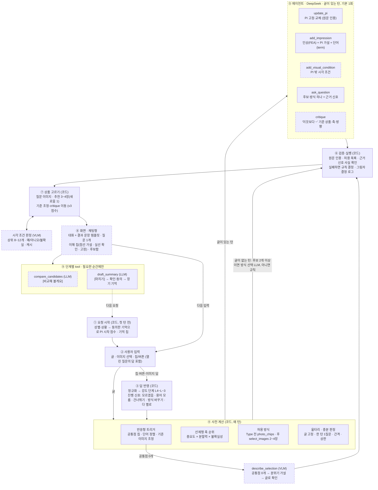

# 대화형 에이전트 파이프라인

팀원이 낸 **tool 안**(턴당 LLM 1회 + tool)을 뼈대로 삼고, **플래너 안**(LLM 플래너가 코드가 정한 행동 중 하나를 고르는 구조)의 규칙 다섯 가지를 얹은 설계다. [Issue #18](https://github.com/jongrionro-debug/HCI_HANDSOME/issues/18)의 "대화형으로 바꾸기" 논의에서 나왔다.

**현재 상태:** 2026-11-24에 뼈대와 아래 [결정 사항](#결정-사항)을 정했고, 2026-11-28에 질문 설계 v1(1-modes·2-feedback·3-mapping, [ADR 0020](../adr/0020-question-loop-v1.md))을 이 파이프라인에 맞췄다. 이 문서가 앞으로 시스템 작업의 기준이다. 아직 구현하지 않았고 ADR로 남기지 않았다. 질문 방식·답 반영·방식 선택은 [질문 설계 작업 공간](../../research/question-design/README.md)([ADR 0017](../adr/0017-question-design-research-workspace.md))이 정해 graph 엔진의 [questions.py](../../src/stylemate_memory/graph/questions.py)에 구현했고 기본으로 켜져 있다([ADR 0020](../adr/0020-question-loop-v1.md)). 이 문서의 `ask_question`·질문 후보 계산·충분 판정은 그 실행 계약을 따른다. 나머지 tool(`update_pi`·`add_impression`·`add_visual_condition`·`critique`)과 단계별 tool은 아직 구현하지 않았다. 기존 결정 중 FEA→PI 가설은 [ADR 0006](../adr/0006-fea-to-pi-hypothesis-comparison.md), 종료 후 동의는 [ADR 0007](../adr/0007-joint-feedback-and-end-consent.md), 카탈로그는 [ADR 0014](../adr/0014-crawled-catalog-pi-v2.md), PI 축과 값 형태는 [ADR 0016](../adr/0016-pi-v3-value-shapes.md)(v3), 기억 warm start는 [ADR 0015](../adr/0015-top-memory-warm-start.md)를 따른다. 한 사용자가 이 구조 전체를 거치는 예시는 [agent-scenario.md](agent-scenario.md)에 있다.

## 결정 사항

2026-11-24 팀 논의에서 정하고 2026-11-28 질문 설계 v1에 맞춰 고쳤다. 수치와 용어처럼 남은 것은 [정할 것](#정할-것)에 있다.

| 항목 | 결정 |
|---|---|
| 화면 | 채팅형. 시스템이 글과 이미지를 함께 보내고, 사용자는 글·이미지 선택·칩/버튼으로 답한다 |
| 뼈대 | tool 안. 에이전트는 행동 tool만 부르고 읽기·반복 tool은 두지 않는다. LLM은 기본 턴당 1회이고, 아래 [LLM 호출 규칙](#llm-호출-규칙)의 경우에만 더 부른다 (2026-11-28 수정) |
| 품목 범위 | 사용자가 요청한 한 품목(상의 또는 하의 등)만 다룬다 |
| 확실한 입력 | 고정 PI로 둔다. 사용자가 다시 말할 때("후드티로 바꿀래", "갈색이 더 나은 거 같아")만 LLM이 교체를 판단해 `update_pi`로 바꾼다 |
| 의미적 표현 | "부드러운", "단정한" 같은 말은 LLM이 `add_impression`으로 인상(FEA)과 PI 가설로 바꾼다 |
| 질문 | PI에서 시작한다. 방식 6개와 비교 제안은 [1-modes.md](../../research/question-design/1-modes.md), 언제 어떤 방식은 [3-mapping.md](../../research/question-design/3-mapping.md)를 따른다. 반응형(행동 직후)이 먼저이고 선제형은 축 순위로 묻는다. Type이 정해지기 전에는 사진 붙은 선택지, 정해진 뒤에는 이미지 여러 장(2~4장)이다. 코드가 후보·허용 방식·사실을 정하고 LLM이 그 안에서 근거 신호와 함께 고른다 |
| 답 반영 | 칩·버튼·이미지 답은 에이전트를 거치지 않고 코드가 [2-feedback.md](../../research/question-design/2-feedback.md)의 강도 단계(L4 고정 ~ L−3 제외)로 반영한다. 가설 칩 확인은 L3이다 |
| 기준 이미지 조정의 기준 상품 | 한 장만 고르면 그 상품, 공통점 칩 "있으면 좋아요"면 고른 상품 중 사용자가 고른다 |
| 결과 문장 | 결과에 따라 달라지는 문장은 코드 템플릿으로 붙인다 |
| PI 밖 시각 조건 | `add_visual_condition`을 따로 두고, 상품 고르기 단계에서 VLM으로 확인한다 |
| 설명용 이미지 | 사진 붙은 선택지(`photo_chips`)가 맡는다. 단어 정렬(`explain_images`)은 사용자가 쓴 단어의 뜻을 맞추는 별도 방식이다 |
| 시작 단계 | 첫 턴 전 코드 단계. 성별·상황과 동의된 기억으로 PI 시작 점수와 기억 칩을 넣는다 (LLM 호출 없음) |
| 글이 없는 턴 | 칩·버튼·이미지 답만 있는 턴은 에이전트를 부르지 않는다. 허용된 질문 후보나 방식이 2개 이상이면 방식 선택 LLM을 1회 부르고, 하나뿐이면 규칙으로 고른다 |

## 두 안 비교

두 안의 구조는 같다. 코드가 후보를 계산하고, LLM은 그 안에서 제안만 하고, 코드가 검증·실행한다. 칩·버튼은 LLM을 거치지 않고, 기억은 사용자가 누른 것만 저장한다. 차이는 LLM을 한 턴에 몇 번 부르는지와 어떤 상황을 tool로 따로 다루는지다.

| 항목 | tool 안 (팀원) | 플래너 안 |
|---|---|---|
| 턴당 LLM 호출 | 1회에 해석·tool 선택·문장 작성을 한꺼번에 | 해석과 플래너를 따로. 가설 갱신·VLM은 필요할 때만 |
| 행동 단위 | 턴마다 쓰는 tool 4개 + 단계별 tool 3개 | 행동 6개 + 코드 도구 5개 |
| 의미적 표현 | `add_impression`: 인상 저장 + PI 가설(점선 칩) | 욕구(FEA)로 가설. 새 욕구가 나오거나 2턴 동안 가설 밖 선택이 이어질 때만 다시 만든다 |
| 질문 방식 | `ask_question`에서 LLM이 고른다. 설명용 이미지·대조 2장·비교 제안 포함 | 코드 규칙으로 기본 방식, 플래너는 그 안에서 조정. 조건 충돌은 글로 확인 고정 |
| "이것보다 ~하게" | `critique` | 없음 |
| 후보 비교 | `compare_candidates` | 없음 (카드 근거만) |
| VLM 쓰는 곳 | 고른 사진들의 공통 분위기 해석 (입력 쪽) | "큰 로고 없이" 같은 조건을 상위 후보 이미지로 확인 (상품 쪽) |
| 기억 | 문장 최대 3개 + [평소에도] [출근할 때만] | 종료 요약 + 동의 |
| 언제 멈추나 | "후보가 충분하면" (기준 미정) | 빈칸 1개 이하, 4턴, 또는 "보여 줘" |
| 검증 실패 시 | 정하지 않음 | 규칙 점수식으로 돌아감 |
| 시작 단계 | 그림에 없음 | 초기 프로필 + 동의된 기억으로 시작 |

## tool 안에서 가져올 것

플래너 안에 없던 기능 다섯 가지와 더 나은 구조 두 가지다. 모두 그대로 가져온다.

| 가져올 것 | 이유 | 예시 |
|---|---|---|
| 턴당 LLM 1회 + tool 호출 | 플래너 호출 한 번(약 2~3초)이 빠진다. DeepSeek의 tool 호출 기능으로 바로 구현할 수 있다 | 한 턴에 `update_pi` + `ask_question`을 함께 호출 |
| `critique` | 보고서 3.7의 "대화로 조건을 조정한다"에 가장 직접 맞는다. 이미지를 본 뒤 말로 미세 조정할 수 있다 | 상품 A를 보고 "이것보다 좀 더 밝게" → A와 비슷하고 톤만 밝은 셔츠 |
| `compare_candidates` | 최종 선택 직전에 사용자 기준으로 장단점을 보여 준다. "판매처 정보 기준" 출처 표시와도 맞는다 | "가장 부드러워요. 구김이 쉬워요" |
| 설명용 이미지 | 용어를 모르는 사용자에게 고르기 전에 모양을 보여 준다. 질문 방식이 하나 늘어난다 | "칼라는 어떤 느낌이 좋으세요?" + 칼라 종류별 사진 |
| 기억 범위 버튼 | 동의할 때 어느 상황에 쓸지도 사용자가 정한다. [ADR 0007](../adr/0007-joint-feedback-and-end-consent.md)의 종료 후 동의와 맞는다 | "여유 있는 핏을 좋아해요" → [평소에도] [출근할 때만] |
| `describe_selection` | 고른 사진들에 공통 PI가 없으면 지금은 아무것도 바뀌지 않는데, 이 빈틈을 메운다 | 핏·색·칼라가 다 다른 3장 → "차분하고 빈티지한 분위기 같아요" (점선 칩) |
| 원문 인용 확인 | `update_pi`는 사용자 말에 근거가 있을 때만 PI를 고정한다. LLM이 없는 조건을 만드는 걸 막는다 | "검정 셔츠" 인용이 있어야 `Color=검정` 고정 |

## 보완할 것

tool 안에서 아직 비어 있거나 위험한 부분 여덟 가지다. 두 번째부터 여섯 번째까지는 플래너 안의 규칙으로 바로 채울 수 있다.

| 문제 | 예시 | 보완 방법 |
|---|---|---|
| 문장이 tool 결과보다 먼저 쓰인다 | `critique`에서 코드가 상품을 못 찾았는데 "더 밝은 걸 찾았어요"라고 말함 | 결과에 따라 달라지는 문장은 코드 템플릿으로 붙인다. 실패했을 때만 짧게 한 번 더 호출하는 방법도 있다 |
| PI 밖 조건을 담을 곳이 없다 | "큰 로고 없었으면"은 `update_pi`로도, `add_impression`의 PI 가설로도 표현이 안 된다 | `add_visual_condition` tool을 더하고, 상품 고르는 단계에서 VLM으로 상위 8~12개를 확인한다 |
| 질문 방식을 LLM이 혼자 고른다 | 글 질문 쪽으로 쏠리거나, 그 축만 다른 상품이 없는데 이미지 비교를 고름 | 질문 후보마다 허용 방식을 코드가 붙여서 넘긴다. 조건 충돌은 글로 확인 고정 |
| 가설 수명이 정해지지 않았다 | 점선 칩을 무시하거나 거절하면? | 확인하면 확인된 해석(L3, 고정은 아님, [ADR 0020](../adr/0020-question-loop-v1.md)), 거절하면 제거. 새 욕구가 나오거나 2턴 동안 가설 밖 선택이 이어질 때만 다시 만든다 |
| 멈춤 기준이 없다 | "후보가 충분하면" 비교를 제안 | 빈칸 1개 이하, 4턴, "보여 줘" 중 하나면 코드가 충분하다고 판정한다 |
| 검증 실패 처리가 없다 | tool 인자가 사전 밖 값 | 그 호출만 버리고 규칙 점수식으로 다음 행동을 고르고, 로그에 남긴다 |
| 시작 단계가 그림에 없다 | 초기 프로필, 동의된 기억 불러오기 | 첫 턴 전에 코드가 불러와 상태에 넣는다. 빠뜨린 건지 확인이 필요하다 |
| 용어가 보고서와 다르다 | "인상" vs 보고서·[ADR 0006](../adr/0006-fea-to-pi-hypothesis-comparison.md)의 FEA | 인상을 FEA의 한 종류(미적 표현)로 정리한다 |

하나의 호출이 해석·tool 선택·문장을 모두 맡으면, 문제가 생겼을 때 어느 부분이 틀렸는지 구분하기 어렵다. 그래서 tool 호출마다 인자와 검증 결과를 따로 기록한다(검증 방법 참고).

## 합친 파이프라인

tool 안의 흐름을 뼈대로, 에이전트 앞뒤의 코드 단계에 플래너 안의 규칙과 질문 설계 v1을 넣었다. 점선은 지금 코드에 아직 없는 부분이다. 지금 코드는 에이전트 대신 `parse_turn`과 방식 선택 LLM을 따로 부른다([ADR 0020](../adr/0020-question-loop-v1.md)).

에이전트는 코드가 미리 계산한 후보 순위·허용 방식·사실과 열린 질문을 받아 tool을 고른다. 코드가 검증한 뒤에만 PI와 화면이 바뀐다. "더 밝은 셔츠를 찾았어요"처럼 결과에 따라 달라지는 문장은 코드가 결과를 보고 템플릿으로 붙인다.

### LLM 호출 규칙

턴당 LLM은 기본 1회이고, 아래 경우에만 더 부른다. 숫자 상한은 두지 않는다. 목록에 없는 상황에서 더 부르지 않으면 한 턴은 재시도를 포함해 최대 2회가 된다.

| 상황 | LLM·VLM 호출 |
|---|---|
| 글이 있는 턴 | 에이전트 1회 (해석·tool 선택·질문 선택) |
| 글이 없는 턴 (칩·버튼·이미지만) | 허용된 질문 후보나 방식이 2개 이상일 때만 방식 선택 LLM 1회. 하나뿐이면 규칙 |
| 출력이 검증에 실패 | 같은 입력으로 1회 재시도. 다시 실패하면 규칙 결정 |
| 고른 이미지의 공통점 0개 | `describe_selection` (VLM) |
| 시각 조건이 있고 상품을 보여 주는 턴 | 시각 조건 판정 (VLM, 상위 8~12개, 캐시) |
| [비교해 볼게요] · [마치기] | `compare_candidates` · `draft_summary` 각 1회 |

결정 로그에 턴마다 LLM·VLM 호출 수와 응답 시간을 남긴다. 파일럿에서 느린 턴이 있으면 그때 상한이나 시간 예산(예: 한 턴 8초를 넘으면 규칙으로)을 정한다.

### 한 턴에서 누가 무엇을 하나

| 단계 | 주체 | 하는 일 |
|---|---|---|
| ① 요청 시작 | 코드 | 첫 턴 전에 성별·상황과 동의된 기억을 상태에 넣는다 |
| ③ 답 반영 | 코드 | 칩·버튼·이미지 답을 강도 단계로 반영하고 진행 신호를 남긴다 ([2-feedback.md](../../research/question-design/2-feedback.md)) |
| ④ 사전 계산 | 코드 | 반응형 트리거, 선제형 축 순위, 허용 방식, 울타리, 충분 판정 ([3-mapping.md](../../research/question-design/3-mapping.md)) |
| ⑤ 해석과 선택 | 에이전트(LLM, 기본 1회) | 글이 있을 때. 사용자 말을 해석해 필요한 tool만 부른다. 질문은 후보 순위 안에서 근거 신호와 함께 고른다 |
| ⑥ 검증·실행 | 코드 | 원문 인용·허용 목록·근거 신호를 확인하고 PI를 갱신한다. 실패한 호출은 버리고 규칙 결정을 쓴다. 규칙 결정은 그림자로 기록한다 |
| ⑦ 상품 고르기 | 코드 (+VLM) | 질문 방식에 맞는 이미지와 추천 상품을 고른다. 시각 조건이 있으면 상위 8~12개만 VLM으로 확인한다 |
| ⑧ 화면 | 코드 | 대화 메시지, 결과 문장 템플릿, 질문 하나, 이해 칩, 후보함 |
| 단계별 tool | LLM 또는 VLM | 공통점이 없을 때, [비교해 볼게요], [마치기]를 누를 때만 |

### 상품 고르기

| 이미지 | 언제 | 고르는 기준 |
|---|---|---|
| 사진 붙은 선택지 (`photo_chips`) | Type이 정해지기 전, "용어 모름" 뒤 | 값마다 같은 종류 옷의 대표 사진, 최대 4개 |
| 이미지 여러 장 (`select_images`) | 한 Type 안에서 사진 방식 축을 물을 때 | 그 축 값만 다르고 나머지 확인된 PI가 같은 상품 2~4장. 2장이면 대조 화면 |
| 단어 정렬 (`explain_images`) | 사용자가 쓴 단어가 한 축 안에서 두 뜻 이상일 때 | 해석 값마다 대표 사진 |
| 기준 이미지 조정 (`relative_adjust`) | 한 장만 골랐을 때, "있으면 좋아요", 고른 상품을 2턴 연속 유지 | 기준 상품 1장 + 조금/훨씬 칩. 결과는 v3 점수 ±0.5/±1.0(Tone은 L* ±5/±15) 이동 목표에 가까운 상품 |
| critique 결과 | 글로 "이것보다 ~하게" | 기준 조정과 같은 이동 계산. 없으면 템플릿 문장 |
| 추천 3~4장 | 질문하지 않는 턴 | 고정 PI·숨김 통과, 점수 순. 기억을 적용했으면 새로움 1장 |

모든 이미지는 고정 PI와 숨김 조건을 통과한 상품에서만 고르고, 모델이 채운 PI도 쓴다. 이미지 질문이 뜨면 추천 상품을 대신한다. 시각 조건 판정이 실패하거나 통과한 상품이 없으면 PI 결과를 그대로 보여 주고 "로고 여부는 확인하지 못했어요" 같은 한 줄을 붙인다.

## tool 목록

tool 안의 7개에 `add_visual_condition` 하나를 더해 8개다. 모든 tool은 제안만 하고, 오른쪽 열을 코드가 확인한 뒤에만 실행된다.

### 에이전트 tool (턴마다, 필요할 때만)

| tool | 언제 | 하는 일 | 코드가 확인할 것 |
|---|---|---|---|
| `update_pi` | 확실한 PI 입력 | PI 칸을 고정하거나 교체 | 원문 인용, 사전 값 |
| `add_impression` | 의미적 표현(FEA) | 인상 저장 + PI 가설(점선 칩). 한 단어가 한 축 안에서 여러 값으로 읽히면 단어(`term`)와 값들을 함께 낸다 → 단어 정렬 트리거 | 가설 값이 사전 안인지, 같은 인상 중복 |
| `add_visual_condition` (새로 추가) | PI로 못 하는 시각 조건 | 대상·방향·강도(꼭/원함)로 저장 | 원문 인용 |
| `ask_question` | 질문 후보가 있을 때 | 반응형·선제형 후보 순위에서 하나 + 허용된 방식 하나 + 근거 신호 + 문장. 선제형만 묻지 않기로 할 수 있다 | 후보 목록 안인지, 허용 방식인지, 근거 신호가 사실인지, 1위가 아니면 신호가 있는지 |
| `critique` | 글로 "이것보다 ~하게" | 기준 상품·축·방향·정도로 변환. 이동은 기준 이미지 조정과 같은 계산 | 기준 상품이 화면에 있었는지, 축이 순서형인지. 결과가 없으면 템플릿 문장 |

`ask_question`의 방식은 [1-modes.md](../../research/question-design/1-modes.md) v1의 여섯 가지다: 이미지 여러 장(`select_images`), 자연어 질문(`text_options`), 단어 정렬(`explain_images`), 공통점 칩(`reason_chips`), 기준 이미지 조정(`relative_adjust`), 사진 붙은 선택지(`photo_chips`). 비교 제안(`propose_compare`)은 질문 화면을 빌린 흐름 전환이다. 질문이 열려 있을 때 사용자가 글로 답하면 에이전트가 그 질문의 대상·축을 받아 해석하고 코드가 질문을 닫는다.

### 단계별 tool (필요한 순간에만)

| tool | 언제 | 하는 일 | 코드가 확인할 것 |
|---|---|---|---|
| `compare_candidates` | 비교 제안에서 [비교해 볼게요]를 누를 때 | 사용자 기준으로 장단점 문장 (LLM) | 확인된 속성만 쓰고 출처를 표시 |
| `draft_summary` | [마치기]를 누를 때 | 기억할 문장 최대 3개 + 범위 버튼 (LLM) | 근거 없는 문장 제거. 저장은 사용자가 누른 것만 |
| `describe_selection` | 고른 이미지에 공통점이 없을 때 | 분위기 가설 (VLM) → 글 질문으로 확인 | 가설로만 표시. [맞아요]면 L3, [조금 달라요]면 이미지로 다시 묻기 |

시각 조건 판정(VLM)은 tool이 아니라 코드의 "상품 고르기" 단계 안에서 돈다. 시각 조건이 있고 상품을 보여 주는 턴에만 상위 8~12개를 판정하고, 결과는 캐시한다. 기억 저장·동의·삭제는 지금처럼 tool로 만들지 않는다.

## 검증 방법

합친 구조가 실제로 나은지는 로그와 파일럿으로 확인한다. fake 모드나 구조 검사만으로는 모델 품질을 말할 수 없다.

| 확인할 것 | 어떻게 보나 |
|---|---|
| tool별 거절률 | tool 호출마다 인자, 검증 결과, 규칙으로 돌아갔는지를 로그로 남긴다 |
| 턴당 1회가 충분한지 | 같은 대화 시나리오를 1회 호출과 해석 분리(2회)로 돌려 응답 시간과 해석 정확도를 비교한다 |
| 질문 방식이 적절한지 | 사용자가 방식을 바꾼 비율, 설문 문항 "질문 방식이 적절했다" |
| LLM 선택이 규칙보다 나은지 | 규칙 점수식이 골랐을 행동을 같이 기록해서 비교한다 |
| `critique` 성공률 | 한 축만 한 단계 옮긴 상품을 찾은 비율 |
| `describe_selection` 정확도 | 분위기 가설을 사용자가 확인한 비율 |
| 시각 조건 판정 | 판정 몇 건을 사람이 직접 확인해 일치율과 불확실 비율을 본다 |

## 정할 것

- [x] 뼈대를 tool 안(턴당 LLM 1회)으로 할지 → tool 안 (2026-11-24)
- [x] 결과에 따라 달라지는 문장 → 코드 템플릿 (2026-11-24)
- [x] `add_visual_condition`을 따로 둘지 → 따로 둔다 (2026-11-24)
- [x] 설명용 이미지 → 사진 붙은 선택지(`photo_chips`)가 맡는다 (2026-11-28)
- [x] 초기 프로필과 기억 불러오기 → 첫 턴 전 코드 단계 (2026-11-24)
- [x] 질문 방식·답 반영·방식 선택 → 질문 설계 v1 ([ADR 0020](../adr/0020-question-loop-v1.md), 2026-11-28)
- [x] 멈춤 기준 → 후보함 2개 이상에서 남은 축 1개 이하, 4턴, "보여 줘" (수치는 `가정`)
- [x] 턴당 LLM 호출 → 기본 1회, 정해진 경우에만 추가, 숫자 상한 없이 호출 수·응답 시간 로그 (2026-11-28)
- [ ] 파일럿 뒤 상한·시간 예산이 필요한지
- [ ] "인상"과 FEA 용어를 어떻게 맞출지 (보고서 반영)
- [ ] 시각 조건 판정·`describe_selection`에 쓸 VLM과 판정할 상위 개수
- [ ] 구현: 에이전트 1회 호출로 `parse_turn`과 방식 선택 LLM 합치기, `add_visual_condition`·`critique`·VLM 두 곳·`compare_candidates`, 채팅형 화면
- [ ] 결정 사항을 ADR로 남기기
