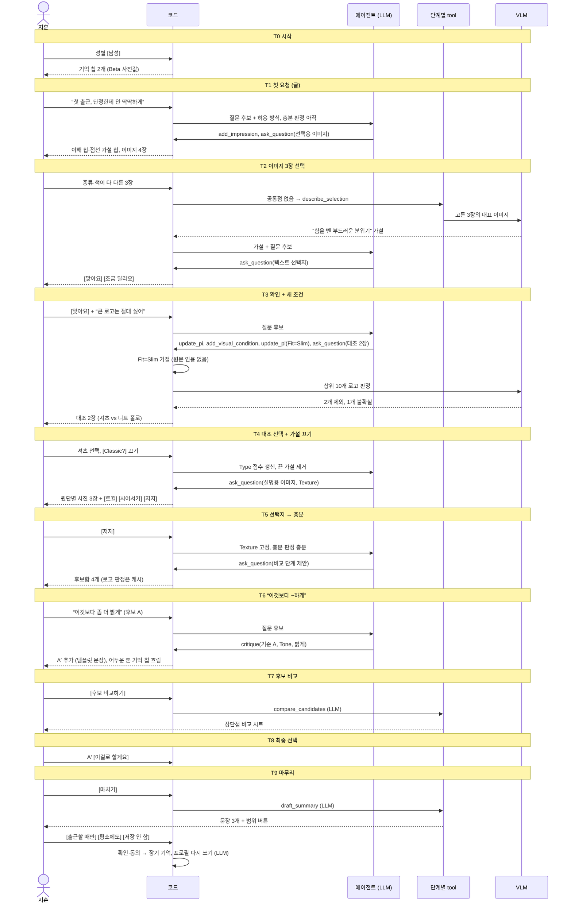

# 에이전트 시나리오: 첫 출근 셔츠 고르기

한 사용자가 [합친 에이전트 파이프라인](agent-pipeline.md)의 모듈과 tool을 모두 거치며 셔츠 하나를 고르고 취향을 기억에 남기는 가상 시나리오다. 설계를 설명하고 구현 점검표로 쓰기 위한 문서이며, 실제 실행 결과가 아니다. 상품명과 대사는 예시다.

## 등장인물과 시작 상태

**지훈**(26)은 다음 주 월요일에 첫 출근하는 신입 사원이다. 한 달 전 LUMI로 주말 외출용 상의를 골랐고, 그때 문장 두 개를 기억에 남기는 데 동의했다. 이번에는 열 턴 동안 셔츠 하나를 고르고 새 기억 두 개를 남긴다.

| 데이터 | 이 시나리오에서 쓰는 것 |
|---|---|
| 상품 카탈로그 `lumi-pi-v2-top` | 상의 1,098개(29CM 476, Wax London 396, Cole Buxton 226). 상품마다 대표 이미지 1장. 지훈이 [남성]을 골라 성별이 남성인 상품만 본다 ([ADR 0014](../adr/0014-crawled-catalog-pi-v2.md)) |
| PI 11축 | Type, Color, Tone, Pattern, Fit, Silhouette, Length, Texture, Fabric, Detail, Style. 축마다 근거 상태(confirmed·derived·inferred)가 있다. Brand·Price는 저장만 하고 조건에는 쓰지 않는다 |
| FEA 사전 | Park et al.(2025)의 소비자 요구 태그 30개(Functional 8·Expressive 13·Aesthetic 9). 예: Expressive › TPO › Business wear(업무복) |
| 상황 사전 | 출근, 발표/미팅, 면접 등 + 계절·활동 |
| 지훈의 장기 기억 | "여유 있는 핏을 좋아해요" [평소에도] → Fit=Relaxed / "어두운 톤을 자주 골라요" [평소에도] → Tone=Dark |

기억은 조건이 아니라 Beta 사전값, 즉 약한 출발점으로만 들어간다([ADR 0015](../adr/0015-top-memory-warm-start.md)). 이번 요청에서 다른 반응이 쌓이면 자연히 약해진다.

## 한눈에 보기

열 턴 동안 LLM은 9회(에이전트 6회, `compare_candidates`·`draft_summary`·프로필 다시 쓰기 각 1회), VLM은 2회 쓴다. 에이전트 tool 5개와 단계별 tool 3개가 모두 한 번 이상 나오고, T0·T8은 코드만 일한다.

## 턴별 진행

턴마다 사용자 입력 → 코드(호출 전) → 에이전트 tool → 코드(호출 후) → 화면 순서다. 에이전트는 턴당 LLM 1회이고, 단계별 tool은 버튼이나 조건이 있을 때만 따로 호출된다.

### T0 · 시작

- **사용자**: 새 요청을 열고 성별 [남성]을 고른다. 상황 칩은 없고, 상황은 대화에서 받는다.
- **코드**: 동의한 장기 기억 2개를 불러와 Fit=Relaxed, Tone=Dark를 Beta 사전값으로 넣고, 성별로 카탈로그를 거른다.
- **화면**: "이렇게 시작할게요" 아래 기억 칩 [여유 있는 핏] [어두운 톤]. 둘 다 x로 끌 수 있다. LLM 호출은 없다.

### T1 · 첫 요청 (글)

> "다음 주 월요일이 첫 출근인데 입고 갈 상의 골라 줘. 단정한데 너무 딱딱하진 않았으면 좋겠어."

- **코드(호출 전)**: 질문 후보를 계산한다. 비어 있는 축 중 상품을 가장 고르게 나누는 Type이 1순위이고, 허용 방식은 [선택용 이미지, 텍스트 선택지]다. 빈칸이 많아 충분 판정은 "아직"이다.
- **`add_impression`**: "단정한데 너무 딱딱하진 않게"를 원문 그대로 인상으로 저장한다. FEA는 Expressive › TPO › Business wear(업무복)과 Expressive › Role › Working professional(직장인 옷차림)에 연결하고, 상황 '출근'도 함께 넘긴다. PI 가설은 Style=Classic, Detail=Collar, Texture=Knit이다.
- **`ask_question`**: Type 후보를 고른다. "딱딱하지 않게"는 말로 설명하기 어려운 표현이라 선택용 이미지를 고른다. 문장은 "첫 출근 축하해요! 단정하지만 편한 쪽으로 네 가지 골라 봤어요. 끌리는 걸 모두 눌러 주세요."다.
- **코드(호출 후)**: 가설 값이 사전 안인지, 질문이 후보와 허용 방식 안인지 확인한다. 그다음 Beta 점수로 종류가 다른 4장을 고른다. 3장은 기억 사전값을 쓰고, 1장은 기억 없이 고른 새로움 칸이다.
- **화면**: 말풍선, 이해 칩 [출근] [단정한데 너무 딱딱하진 않게], 점선 가설 칩 [Classic?] [칼라?] [니트?], 이미지 4장.

### T2 · 이미지 선택, 공통점 없음

- **사용자**: 네이비 니트 폴로, 에크루 린넨 셔츠, 베이지 카디건 3장을 누르고 [반영하기]를 누른다.
- **코드(공통점 분석)**: 세 상품의 Type·Color·Texture가 모두 달라 공통 PI가 없다. 각 값의 Beta 점수만 조금씩 올린다. 에크루·베이지는 Light라 어두운 톤 기억과 반대되는 선택이 처음 쌓인다.
- **`describe_selection`(VLM 1회)**: 고른 3장의 대표 이미지를 보고 "힘을 뺀 부드러운 분위기"라는 가설을 만든다. 확인 전에는 점수에 넣지 않는다.
- **`ask_question`**: 이 가설을 텍스트 선택지로 확인한다. "고르신 옷들은 힘을 뺀 부드러운 느낌이 있어요. 이런 분위기가 맞을까요?" [맞아요] [조금 달라요]
- **화면**: 점선 칩 [힘을 뺀 부드러운 분위기?], 선택지 2개, 입력창.

### T3 · 확인과 새 조건 (칩 + 글)

- **사용자**: [맞아요]를 누르고 이어서 입력한다.

> "응 그런 느낌. 근데 가슴에 큰 로고 있는 건 절대 싫어."

- **코드(칩)**: [맞아요]는 에이전트를 거치지 않고 분위기 가설을 확인된 인상으로 바꾼다.
- **`update_pi`**: Pattern에서 Logo·Graphic을 뺀다(꼭). 인용은 "큰 로고 있는 건 절대 싫어"다.
- **`add_visual_condition`**: 대상 '가슴 로고', 방향 '큰 것 없음', 강도 꼭으로 저장한다. Pattern은 전체 무늬만 담아서 작은 자수 로고와 큰 로고를 구분하지 못하기 때문이다.
- **`update_pi`(잘못된 제안)**: LLM이 "단정"을 넘겨짚어 Fit=Slim을 제안한다. 원문 인용이 없다.
- **`ask_question`**: 다음 빈칸은 여전히 Type이다. 그 축만 다른 대조 상품이 있어서 대조 2장을 고른다. "둘 중 어느 쪽이 더 가까워요?"
- **코드(호출 후)**: Fit=Slim은 인용이 없어 거절하고 로그에 남긴다. 나머지는 실행한다. Pattern으로 걸러진 상위 10개의 대표 이미지를 VLM으로 판정해 큰 로고 2개는 빼고, 불확실 1개는 뒤로 미룬다(VLM 1회). 남은 상품에서 색·핏이 같고 Type만 다른 네이비 셔츠와 네이비 니트 폴로를 고른다.
- **화면**: 칩 [힘을 뺀 부드러운 분위기]가 실선이 되고 [큰 로고 없음 · 꼭]이 생긴다. 대조 2장 카드 아래에는 "큰 로고 없음 · 대표 이미지로 확인"이 붙는다.

### T4 · 대조 선택과 가설 끄기

- **사용자**: 셔츠 쪽을 누르고, 점선 칩 [Classic?]의 x를 누른다. 너무 클래식한 건 아니라는 뜻이다.
- **코드**: 두 장은 Type만 달라서 Type=Shirt 점수만 올린다. [Classic?]은 거절로 보고 제거한다. 같은 가설은 다시 만들지 않는다.
- **`ask_question`**: 다음 빈칸은 Texture다. Twill·Seersucker·Jersey 같은 값은 낯선 말이라 설명용 이미지를 고른다. "셔츠 원단 느낌은 어떤 게 좋으세요?"
- **화면**: 원단별 셔츠 사진 3장에 이름표가 붙고, 아래에 선택지 [트윌] [시어서커] [저지]가 나온다.

### T5 · 선택지 탭, 충분 판정

- **사용자**: 사진을 보고 [저지]를 누른다.
- **코드**: 선택지를 직접 고른 것이라 Texture=Jersey를 고정한다. 남은 빈칸이 Color 하나뿐이라 충분 판정은 "충분"이다.
- **`ask_question`**: 비교 단계 제안을 고른다. "조건에 맞는 후보 4개를 모았어요. 비교해 볼까요?"
- **코드(호출 후)**: 후보 4개를 후보함에 넣는다. 로고 판정은 캐시를 써서 VLM을 다시 부르지 않는다.
- **화면**: 후보함 4개, 카드 근거 "저지 · 셔츠 · 큰 로고 없음", [후보 비교하기] 버튼.

### T6 · "이것보다 ~하게" (글)

> (후보 A, 차콜 저지 셔츠를 보며) "이거 좋은데, 이것보다 좀 더 밝은 색이면 좋겠어."

- **`critique`**: 기준 A, 축 Tone, 방향 "밝게"(Dark → Medium)로 바꾼다.
- **코드**: A와 Type·Texture·Fit이 같고 Tone만 Medium인 상품 A′(그레이 저지 셔츠)를 찾는다. 결과 문장은 코드 템플릿이다: "A와 비슷하고 톤만 밝은 셔츠를 찾았어요." 못 찾았다면 "그 방향으로는 더 없어요"가 붙는다. Tone을 직접 말했으므로 평소 기억 [어두운 톤]은 이번 요청에서 끄고 칩을 흐리게 한다([ADR 0015](../adr/0015-top-memory-warm-start.md)).
- **화면**: A′가 후보함에 추가되고, 기억 칩 [어두운 톤]이 흐려진다.

### T7 · 후보 비교 (버튼)

- **사용자**: A′, 네이비 니트 폴로 B, 에크루 저지 셔츠 C를 두고 [후보 비교하기]를 누른다.
- **코드**: 세 상품의 확인된 PI만 근거 상태와 함께 뽑는다.
- **`compare_candidates`(LLM 1회)**: 지훈의 기준(단정함, 편함, 큰 로고 없음, 밝은 톤)으로 장단점을 쓴다.
    - A′: "셔츠라 가장 단정해요. 중간 톤이라 어두운 옷보다 부드러워 보여요."
    - B: "니트라 가장 편해 보여요. 대신 셔츠보다 덜 단정해요."
    - C: "가장 밝아요. 소재는 판매처 정보 기준이에요."
- **화면**: 비교 시트가 열린다.

### T8 · 최종 선택

- **사용자**: A′를 고르고 확인 시트에서 [이걸로 할게요]를 누른다.
- **코드**: 최종 선택과 근거(대화 원문, 선택 기록)를 요청에 연결한다. LLM 호출은 없다.

### T9 · 마무리와 기억 (버튼)

- **사용자**: [마치기]를 누른다.
- **`draft_summary`(LLM 1회)**: 이번 요청에서 확정된 것으로만 문장 3개를 제안한다. 코드는 근거 없는 문장을 뺀다(여기서는 없음).

| 제안 문장 | 근거 | 지훈의 선택 |
|---|---|---|
| "출근할 땐 부드러운 저지 셔츠를 좋아해요" | T5 선택지, T8 최종 선택 | [출근할 때만] |
| "가슴에 큰 로고가 있는 옷은 피하고 싶어요" | T3 원문 | [평소에도] |
| "출근할 땐 어두운 톤보다 중간 톤이 좋아요" | T6 원문 | [저장 안 함] |

- **코드**: 고른 문장 2개만 내용 확인(`confirm_content`)과 이후 활용 동의(`future_reuse`) 이벤트로 장기 기억에 올린다. 로고 문장은 PI가 아니라 시각 조건으로 연결한다.
- **프로필 다시 쓰기(LLM 1회)**: 동의한 기억 전체를 짧은 취향 프로필로 다시 쓴다. 문장이 바뀐 것만 [바꾸기] [그대로]로 다시 묻는다.
- **다음 요청**: 비슷한 출근 요청이 오면 저지 셔츠가 처음부터 사전값으로 들어가고, 로고 조건은 어느 상황에서나 적용된다.

## FEA·PI가 쌓이는 과정

이해 상태에는 다섯 층이 있다. 직접 말한 PI는 고정되고, FEA는 PI 가설만 만들고, 이미지 선택은 점수만 바꾼다. 기억은 약한 출발점이고, PI로 못 하는 조건은 시각 조건으로 따로 둔다.

| 항목 | 층 | 들어온 경로 | 끝 상태 |
|---|---|---|---|
| 업무복·직장인 옷차림 | FEA (Expressive) | T1 글 → `add_impression` | 인상과 함께 유지 |
| 힘을 뺀 부드러운 분위기 | 인상 | T2 `describe_selection` 가설 → T3 [맞아요] | 확인됨 |
| Style=Classic | PI 가설 | T1 `add_impression` | T4에 사용자가 꺼서 제거 |
| Detail=Collar | PI 가설 | T1 `add_impression` | 가설로 남음 (셔츠 선택과 맞음) |
| Texture | PI 가설 → 직접 | T1 가설 Knit → T5 선택지 Jersey | Jersey 고정 |
| Type=Shirt | PI 점수 | T2 선택, T4 대조 | 점수 높음 (고정 아님) |
| Pattern에서 Logo·Graphic 빼기 | PI 직접 (꼭) | T3 `update_pi` | 필터 |
| 큰 가슴 로고 없음 | 시각 조건 (꼭) | T3 `add_visual_condition` | VLM으로 확인, 장기 기억 [평소에도] |
| Fit=Relaxed | 기억 사전값 | T0 장기 기억 | 약하게 유지 |
| Tone | 기억 사전값 → 직접 | T0 Dark, T2 반대 선택, T6 `critique` Medium | Medium, 기억 칩은 흐림 |
| Fit=Slim | 거절된 제안 | T3 `update_pi` (인용 없음) | 반영 안 함, 로그만 남음 |

FEA는 요구의 방향이고 상품의 성능을 확인해 주지 않는다. 예를 들어 저지를 골랐다고 실제 착용감이 편하다는 뜻은 아니다.

## 이 시나리오로 확인할 것

모든 모듈과 tool 8개가 한 번 이상 나오고, `ask_question`의 다섯 방식도 T1~T5에 한 번씩 나온다. 그래서 이 시나리오를 구현 점검표로 쓸 수 있다.

| 모듈·tool | 등장 턴 | 확인할 점 |
|---|---|---|
| 기억 불러오기 (warm start) | T0, T6 | 직접 말한 축에서 기억이 꺼지는지 |
| 공통점 분석 | T2 | 공통점이 없을 때 `describe_selection`으로 넘어가는지 |
| 질문 후보 계산과 허용 방식 | T1, T3~T5 | 대조 상품이 없으면 대조 2장이 허용 방식에서 빠지는지 |
| 충분 판정 | T1, T5 | 빈칸이 1개 이하일 때 비교 단계를 제안하는지 |
| `add_impression` | T1 | FEA 연결과 PI 가설이 사전 안에 있는지 |
| `describe_selection` | T2 | 확인 전에는 점수에 들어가지 않는지 |
| `update_pi` + 원문 인용 검사 | T3 | 인용 없는 Fit=Slim이 거절되고 로그에 남는지 |
| `add_visual_condition` + VLM 판정 | T3, T5 | 불확실 상품을 뒤로 미루는지, 캐시를 다시 쓰는지 |
| `ask_question` 5가지 방식 | T1 선택용 이미지, T2 텍스트 선택지, T3 대조 2장, T4 설명용 이미지, T5 비교 제안 | 상황에 맞는 방식을 고르는지 |
| 가설 수명 규칙 | T4 | 꺼진 가설이 다시 나오지 않는지 |
| `critique` + 결과 문장 템플릿 | T6 | 못 찾았을 때 문장이 맞게 바뀌는지 |
| `compare_candidates` | T7 | 확인된 속성만 쓰고 출처를 밝히는지 |
| `draft_summary` + 확인·동의 | T9 | 근거 없는 문장을 빼고, 누른 문장만 저장하는지 |

### 쓰는 법

- **데모 대본**: 각 턴의 사용자 입력을 그대로 쓰면 팀 발표나 파일럿 안내에서 전체 흐름을 보여 줄 수 있다.
- **통합 테스트**: "FEA·PI가 쌓이는 과정" 표를 각본 모델 통합 테스트의 기대 상태로 쓸 수 있다. fake 모드로는 배선만 확인되고, 실제 모델 품질은 따로 봐야 한다.

### 시나리오를 쓰며 드러난 미정 사항

- [ ] 상황('출근')을 어느 tool이 받을지. 지금은 `add_impression`이 함께 넘긴다고 가정했다
- [ ] `describe_selection` 결과를 같은 턴의 에이전트에 넘길지 (T2는 넘긴다고 가정)
- [ ] 선택지 탭처럼 코드가 바로 반영하는 입력 뒤에도 에이전트를 불러 다음 질문을 만들지 (T5는 부른다고 가정)
- [ ] "절대 싫어"는 꼭, "없었으면"은 원함처럼 강도를 나누는 기준
