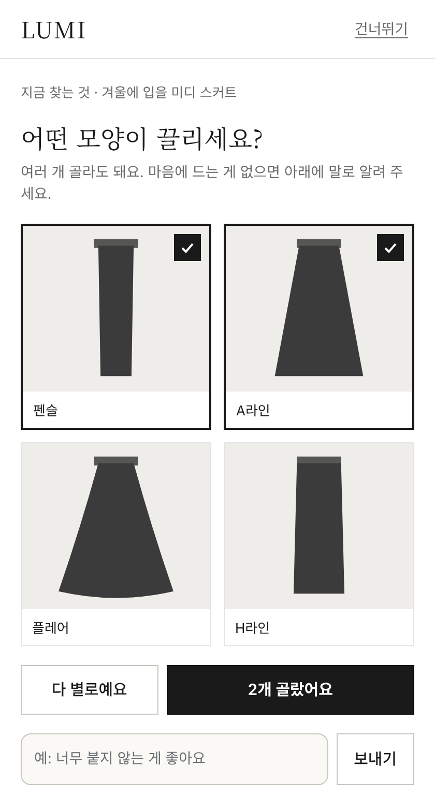
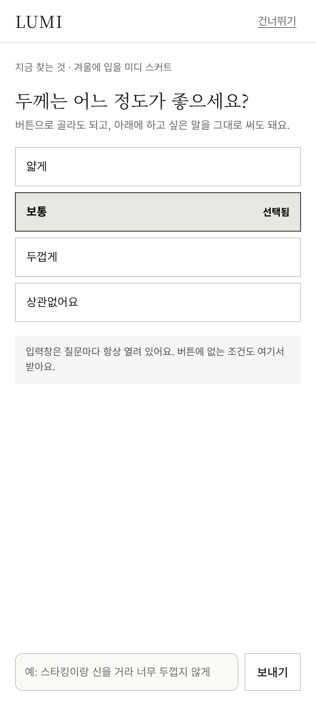
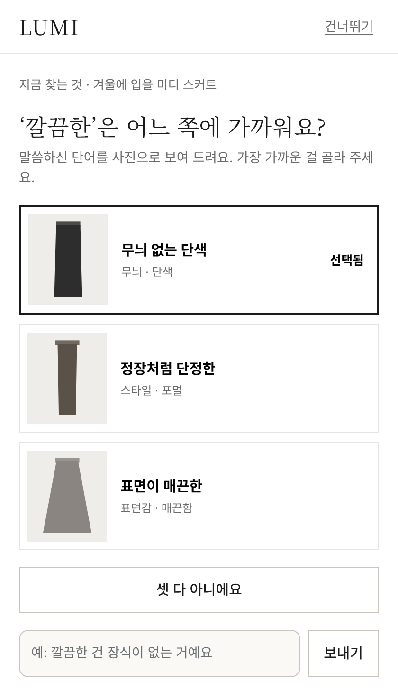
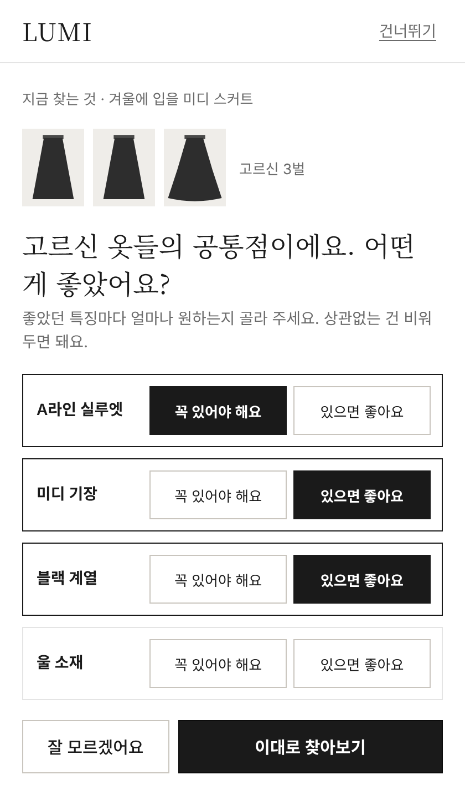
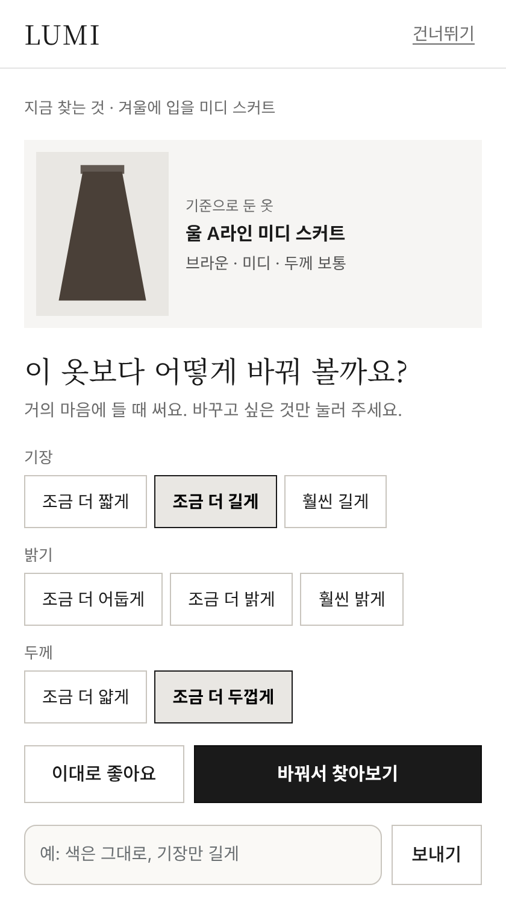
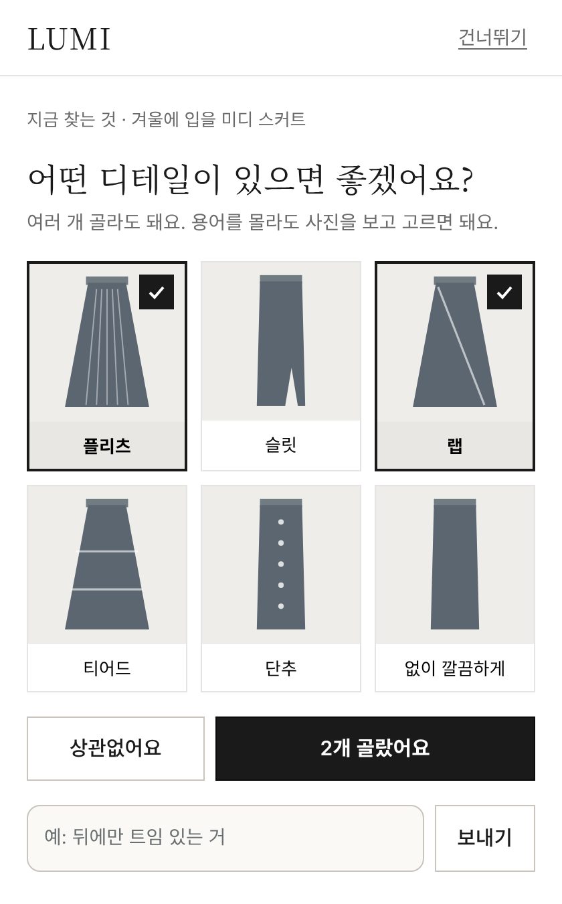

# ① 질문 방식

- 주인: 파트 1 담당 준상 (Issue [#26](https://github.com/jongrionro-debug/HCI_HANDSOME/issues/26))
- 상태: **v1 확정** (2026-11-28). 방식 6개(확정 4개 + 추가 2개 채택)로 목록을 고정했다. 대조 2장(`contrast_pair`)은 1번의 2장 형태로 합쳤다. 구현과 결정 이유는 [ADR 0020](../../docs/adr/0020-question-loop-v1.md)에 있다.
- 다른 파트는 이 파일을 직접 고치지 않고 PR 리뷰 댓글로 제안한다.
- 근거 칸: 왜 필요한지 한 문장을 쓰고 뒤에 뒷받침하는 논문을 붙였다. 카드가 있는 논문은 카드 ID도 적었다. 논문이 없으면 `가정`이다.

## 확정 방식 (4개)

v1에서 반드시 구현한다.

| # | 방식 (코드 이름) | 화면과 사용자 행동 | 필요 조건 | 답 형태 | 근거 (한 문장 — 논문) |
|---|---|---|---|---|---|
| 1 | 이미지 여러 장 선택 (`select_images`) | 그 축 값이 서로 다른 이미지 2~4장에서 끌리는 것을 여러 장 고른다. 2장이면 대조 화면(하나 고르기 + 둘 다 좋아요 / 둘 다 아님) | Type이 하나로 정해진 적격 상품 중 그 축 값만 다른 2~4장 | 다중 선택, 다 별로, 텍스트 | 말로 설명하기 어려운 취향을 고르는 것만으로 드러내고, 최종 선택에도 쓴다. — Joachims et al., SIGIR 2005 (`joachims2005-relative-preference`) |
| 2 | 자연어 질문 (`text_options` + 입력창) | 짧은 질문 + 버튼 몇 개. 입력창은 항상 열려 있다 | 없음 | 단일 선택, 텍스트, 건너뛰기 | 사용자가 이미 아는 조건과 시스템이 예상하지 못한 요구는 말로 받는 것이 가장 빠르다. — Guo et al., NeurIPS 2018 (`guo2018-natural-language-feedback`) |
| 3 | 단어 정렬 (`explain_images`) | "'깔끔한'은 어느 쪽에 가까워요?" + 그 단어의 해석 후보마다 사진과 이름표 | 해석 후보 값마다 대표 이미지. 사용자가 쓴 단어 | 값 하나 선택, 텍스트 | 같은 단어도 사람마다 떠올리는 모습이 달라서, 사용자가 쓴 단어의 뜻을 이미지로 확인해 시스템 라벨과 맞춘다. — Kovashka & Grauman, IJCV 2015, [Discovering Attribute Shades of Meaning with the Crowd](https://arxiv.org/abs/1505.04117) |
| 4 | 공통점 칩 (`reason_chips`, 새 방식) | "고르신 옷들의 공통점이에요. 어떤 게 좋았어요?" + 공통 값 칩 여러 개. 칩마다 "꼭 있어야 해요 / 있으면 좋아요"를 고른다 | 직전 선택이 2장 이상이고, 고른 상품끼리 겹치는 값이 2개 이상 | 칩 다중 선택(칩마다 정도), 모르겠음 | 여러 장을 고르면 무엇 때문에 골랐는지 알 수 없어서, 고른 상품들의 공통 특징을 칩으로 보여 주고 사용자가 확인하게 한다. — McCarthy et al., IUI 2005, [Experiments in Dynamic Critiquing](https://doi.org/10.1145/1040830.1040871) |

- **최대 4장**이다(`가정`, 파일럿에서 확인). 지금 그리드 8장은 여러 축을 섞어 보여 주는 화면이고, 질문은 한 축만 묻는다. 이미지 질문이 떠 있는 동안에는 8장 그리드를 대신한다(3-mapping 9절). 질문 이미지에는 모델이 채운 PI도 쓴다.
- 4번의 "꼭 있어야 해요"는 고정(pin), "있으면 좋아요"는 점수 올림에 해당한다. 반영 방식은 파트 2가 정한다. "더 많이 보기"는 상품을 더 불러오는 버튼으로 읽혀서 바꿨다.

## 추가 방식 (2개, 2026-11-28 채택)

리뷰에서 채택했다. "정할 것" 칸에는 정한 결과를 적었다.

| # | 방식 (코드 이름 안) | 화면과 사용자 행동 | 정할 것 | 근거 (한 문장 — 논문) |
|---|---|---|---|---|
| 5 | 기준 이미지 + "이것보다 더 ~" (`relative_adjust`) | 기준 상품 1장 + `조금 더 여유롭게` `훨씬 여유롭게` `조금 더 밝게` 같은 칩. 순서형 축(Fit·Tone·Length·Weight)에 쓴다 | 정함: 이미지 질문에서 한 장만 골랐을 때, 공통점 칩 "있으면 좋아요"를 골랐을 때, 고른 상품을 2턴 연속 유지할 때([3-mapping.md](3-mapping.md) 9절). 칩 + 입력창. v1은 기준 상품을 고른 상품 중 첫 장으로 둔다 | 거의 맞는 상품이 있을 때는 처음부터 다시 묻는 것보다 그 상품을 기준으로 조정하는 것이 빠르다. — Kovashka et al., CVPR 2012, [WhittleSearch](https://vision.cs.utexas.edu/whittlesearch/) |
| 6 | 사진 붙은 선택지 + 칩 (`photo_chips`) | 텍스트 질문 + 선택지마다 사진 썸네일. 칩처럼 여러 개를 누를 수 있다 | 정함: 3번과 합치지 않는다(3은 사용자가 쓴 단어, 6은 시스템이 묻는 값). 다중 선택은 Type·Style·Pattern·Detail, 나머지 축은 단일. 선택지 최대 4개. Type이 정해지기 전과 "용어 모름" 뒤에 쓴다 | 용어를 몰라도 사진을 보고 답할 수 있고, 여러 개를 함께 고를 수 있어야 실제 의도에 가깝다. — Yuan et al., WWW 2024, [Asking Multimodal Clarifying Questions in Mixed-Initiative Conversational Search](https://arxiv.org/abs/2402.07742) |

- 싫어요 확인(`exclude_check`)은 v1에서 뺐다(2026-11-28). 화면이 두 단계라 복잡하고 근거 논문이 없다. "별로"는 지금처럼 2번 누르면 그 상품만 숨긴다.

## 예시 화면

방식마다 화면 한 장이다. 모두 "겨울에 입을 미디 스커트를 찾는 중"이라는 같은 상황이다. 옷 사진 자리는 상품 사진 대신 단순한 그림이고, 버튼은 눌린 상태만 그린 정지 화면이다. 5·6은 추가 후보다.

| 1 이미지 여러 장 선택 | 2 자연어 질문 | 3 단어 정렬 |
|---|---|---|
|  |  |  |

| 4 공통점 칩 | 5 기준 이미지 + "이것보다 더 ~" | 6 사진 붙은 선택지 + 칩 |
|---|---|---|
|  |  |  |

## v0에서 그대로 둔 것

| 코드 이름 | 방식 | 상태 |
|---|---|---|
| `contrast_pair` | 대조 2장 (한 축만 다른 두 장) | 1번의 2장 형태로 합쳤다(2026-11-28). 원래 메모: 선택은 상대 선호로 읽을 때 정확하다. — Joachims et al., SIGIR 2005 (`joachims2005-relative-preference`). 확인된 PI만으로 쌍이 충분히 나오는지 먼저 센다 |
| `propose_compare` | 비교 단계 제안 | 질문 방식이 아니라 흐름 전환으로 본다. 언제 띄울지는 파트 3 |
| 색 견본 칩 (경호 제안) | 색 이름 대신 견본 칩 | 보류 제안. Color는 대화로 먼저 묻고(ADR 0016), 사진 속 색과 견본이 어긋날 수 있다 |

## 계약에 필요한 변경 (#29에서 합의, ADR 0020 결정 2)

4·5번은 질문 하나가 여러 축에 걸치거나 답에 정도가 붙는다. 지금 계약은 질문 하나에 축 하나다.

- Option에 `axis` 추가 (4: 칩마다 축이 다르다) → 채택
- Answer에 정도 추가 (4: 꼭/있으면 좋음, 5: 조금/훨씬) → 칩마다 다른 정도라 `Answer.strengths`(`only`·`more`)로 채택. 5의 조금/훨씬과 방향은 선택지(Option)에 둔다
- Candidate에 사용자 단어 전달 (3: 질문 문구에 사용자가 쓴 단어를 넣는다) → `Candidate.term`으로 채택

## A 전에 답할 것

- [x] 선택용 이미지 장수 N → 4장 (`가정`)
- [x] 설명용 이미지를 따로 둘지 → 단어 정렬(3)로 쓰고, 사진 붙은 선택지(6)와 합칠지는 리뷰에서 정한다
- [x] 비교 단계 제안이 질문 방식인지 → 흐름 전환으로 본다
- [x] 방식마다 "말로 표현하는 부담을 줄인다"는 근거 → 남은 방식은 모두 논문 근거가 있다
- [x] 추가 후보 5·6 채택 여부 → 채택(6번 코드 이름 `photo_chips`)
- [x] 계약 변경 합의 → #29, ADR 0020
