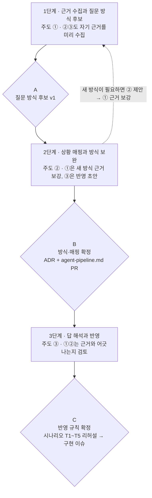

# 질문 설계 작업 공간

LUMI가 사용자에게 **어떤 방식으로 묻고(①), 어떤 상황에서 그 방식을 고르고(②), 답을 어떻게 해석해 반영할지(③)**를 근거 기반으로 정하는 곳이다. 세 사람이 각자 브랜치에서 작업하고 push·PR로 공유한다. 구조를 이렇게 둔 이유는 [ADR 0017](../../docs/adr/0017-question-design-research-workspace.md)에 있다.

- 이 폴더: 근거 카드와 파트별 작업 결과(초안 → 확정)
- 확정된 결정과 그 이유: `docs/adr/`의 새 ADR
- 확정된 동작 규칙: [agent-pipeline.md](../../docs/specs/agent-pipeline.md) 갱신 PR

## 한눈에



세 파트의 결정은 **같은 근거를 이어 써야 한다.** 예를 들어 ①이 "선택은 절대 평가보다 상대 선호로 읽을 때 정확하다"는 근거로 대조 2장을 채택하면, ②는 "그 축만 다른 상품 쌍이 있을 때" 이 방식을 쓰고, ③은 선택을 두 장이 다른 축에 대한 상대 선호로만 반영한다. 근거 카드 하나가 세 결정을 관통한다.

## 파일 구성

```
research/question-design/
├── README.md              이 안내
├── evidence/              근거 카드. 카드 1장 = 파일 1개
│   ├── _template.md       새 카드를 만들 때 복사하는 틀
│   └── <카드 ID>.md
├── 1-modes.md             ① 질문 방식
├── 2-mapping.md           ② 상황 매핑
└── 3-feedback.md          ③ 답 해석·반영
```

| 파일 | 주인 | 다른 사람이 할 일 |
|---|---|---|
| [1-modes.md](1-modes.md) | ① | PR 리뷰 댓글로 제안 |
| [2-mapping.md](2-mapping.md) | ② | PR 리뷰 댓글로 제안 |
| [3-feedback.md](3-feedback.md) | ③ | PR 리뷰 댓글로 제안 |
| `evidence/*.md` | 카드를 만든 사람 | 누구나 새 카드 추가. 남의 카드는 PR 리뷰 댓글로 |

**충돌을 피하는 규칙은 두 개뿐이다.** 파트 파일은 주인만 고치고, 근거 카드는 한 장에 파일 하나로 새로 만든다. 그러면 세 브랜치가 같은 줄을 건드릴 일이 거의 없다.

## 작업 방법

### 브랜치와 커밋

| 항목 | 규칙 | 예 |
|---|---|---|
| 브랜치 | `qd/<파트>-<이름>` (파트: `modes`·`mapping`·`feedback`) | `qd/modes-kyeongho` |
| 커밋 | `qd(<파트 또는 evidence>): <한 줄 요약>` | `qd(evidence): joachims2005-relative-preference 추가` |

```sh
# 시작: main 최신에서 내 브랜치 만들기
git switch main && git pull
git switch -c qd/modes-kyeongho

# 근거 카드 추가
cp research/question-design/evidence/_template.md \
   research/question-design/evidence/<카드 ID>.md
# (카드 작성 후)
git add research/question-design
git commit -m "qd(evidence): <카드 ID> 추가"

# 공유: 자주 push하고, 첫 push 때 Draft PR을 연다
git push -u origin qd/modes-kyeongho
gh pr create --draft --base main --title "qd: ① 질문 방식" --fill   # 또는 GitHub 화면에서 Draft PR
```

- **push는 자주 한다.** 하루 작업이 끝날 때마다 push하면 다른 사람이 Draft PR의 Files changed에서 바로 볼 수 있다.
- **Draft PR은 첫 push 때 연다.** 진행 중인 작업을 보여 주는 창구다. PR 설명은 기존 [PR 템플릿](../../.github/pull_request_template.md)을 쓴다.
- **다른 사람 작업 보기**: GitHub에서 브랜치를 고르거나 PR을 연다. 로컬에서는 `git fetch` 후 `git show origin/qd/modes-kyeongho:research/question-design/1-modes.md`처럼 본다.
- **main 반영 받기**: 확인 지점 뒤에는 `git fetch && git merge origin/main`으로 내 브랜치를 최신으로 맞춘다.

### 리뷰와 머지

- 리뷰어는 **다른 파트 1명 이상**이다. 카드의 "검토" 단계가 이 리뷰다.
- 머지 조건은 리뷰 승인과 CI(`repository-checks`) 통과다. 로컬에서 먼저 확인하려면 `python3 scripts/check_repository.py`를 돌린다.
- CI가 Markdown 상대 링크를 검사한다. **아직 main에 없는 카드는 링크 대신 백틱 ID로 쓴다** (`joachims2005-relative-preference`). 링크로 쓰면 그 카드가 머지되기 전까지 CI가 실패한다.

## 근거 카드

카드는 **논문 하나가 아니라 주장 하나에 한 장**이다. 틀은 [evidence/_template.md](evidence/_template.md)에 있다.

- **카드 ID = 파일 이름**: `<첫 저자 성><연도>-<주장 요약>`, 소문자 영문·숫자·하이픈. 예: `joachims2005-relative-preference`. 이름으로 정하므로 번호를 맞출 필요가 없다.
- **핵심 결과는 자기 말로** 한두 문장 쓴다. 원문을 길게 붙여 넣지 않는다.
- **원래 도메인과 적용 한계는 필수다.** 대부분 패션이 아닌 연구라서 우리에게 옮겨 올 수 있는지가 중요하다.
- **반대 근거도 카드로** 남기고 `stance: 반대`로 표시한다. "상황에 따라 다르다"는 ②의 전제는 반대 근거가 있어야 선다.
- **상태**: `수집`(내 브랜치에 커밋) → `검토`(PR 리뷰 통과) → `채택`·`보류`·`기각`(확인 지점 회의에서 결정).

파트 파일의 표에서는 근거 칸에 카드 ID를 적는다. 근거를 못 찾은 항목은 **`가정`**이라고 적는다. `grep -n "가정" research/question-design/*.md`로 모으면 그대로 보고서 Limitation과 user study 검증 목록이 된다.

## 확인 지점

확인 지점마다 **세 사람 모두 자기 PR을 main에 머지**한다. 카드와 초안을 공유하기 위해서다. 다음 단계는 main에서 새 브랜치로 시작한다.

| 지점 | 넘어가는 조건 | main에 남는 것 |
|---|---|---|
| A | 1-modes.md의 방식마다 필요 조건·답 형태가 있고 근거 카드나 `가정` 표시가 있다. ②는 쓸 상황이 있는지, ③은 해석할 수 있는지 확인한다 | 질문 방식 후보 v1, 지금까지의 카드 |
| B | 2-mapping.md의 모든 상황에 기본·허용 방식과 판단 주체가 있다. 방식 목록은 여기서 고정한다 | 매핑 v1, 질문 방식·선택 규칙 ADR(Proposed), agent-pipeline.md 갱신 PR |
| C | 3-feedback.md의 방식별 답 유형마다 "무엇이 바뀌고 무엇이 안 바뀌나"가 있다. 시나리오 리허설을 통과한다 | 반영 규칙 v1, 반영 규칙 ADR 또는 B의 ADR 보강, 구현 이슈 |

B 이후 방식 목록을 바꾸려면 ADR을 고친다. 확정된 방식이 계속 바뀌면 ③의 반영 규칙이 흔들린다.

### 시나리오 리허설

확인 지점 회의에서 [agent-scenario.md](../../docs/specs/agent-scenario.md)의 T1~T5를 따라가며 턴마다 세 질문에 근거 카드로 답한다. T1~T5에 지금 질문 방식 5가지가 한 번씩 나온다.

1. 이 턴에서 왜 이 방식인가? (①)
2. 왜 이 상황에 이 방식을 골랐나? 누가 골랐나, 규칙인가 LLM인가? (②)
3. 사용자의 답이 무엇을 바꾸고 무엇을 바꾸지 않나? (③)

답하지 못한 칸이 다음 단계의 할 일이다.

## 킥오프에서 정할 것

- [ ] 파트별 담당자 (① ② ③)
- [ ] 확인 지점 A·B·C 날짜
- [ ] 질문 방식 코드 이름 고정 (1-modes.md의 v0 이름을 그대로 쓸지)
- [ ] "상황"과 "의도" 구분: 상황은 출근·계절 같은 사실, 의도는 FEA 요구로 볼지
- [ ] 근거 카드 틀의 칸을 더하거나 뺄지
- [ ] 채택 기준: 방식 하나에 카드 몇 장, 반대 근거가 있을 때 어떻게 판단할지
- [ ] 새 방식 제안의 검토 기한 (예: 이틀)
- [ ] 묶음 Issue를 만들 사람 (task 템플릿, Acceptance에 A·B·C 체크박스)

## 출발점

- **1-modes.md v0**: agent-pipeline.md의 `ask_question` 5가지
- **2-mapping.md v0**: 2026-11-22에 정리한 상황별 기본 방식과 결정 3단계(코드가 허용 방식 → 고정 규칙 → LLM 선택)
- **3-feedback.md v0**: 지금 graph 엔진과 제안안에 이미 있는 반영 규칙(ADR 0013 결정 8 등)
- **근거 카드 6장**: 아래 문헌의 초록만 확인한 `수집` 상태다. 본문을 읽고 고쳐 쓴 뒤 검토로 올린다

| 카드 ID | 주로 쓸 파트 |
|---|---|
| [guo2018-natural-language-feedback](evidence/guo2018-natural-language-feedback.md) | ① (반대 근거) |
| [bollen2010-choice-overload](evidence/bollen2010-choice-overload.md) | ① |
| [knijnenburg2011-user-type-interaction](evidence/knijnenburg2011-user-type-interaction.md) | ② |
| [christakopoulou2016-question-selection](evidence/christakopoulou2016-question-selection.md) | ② ③ |
| [joachims2005-relative-preference](evidence/joachims2005-relative-preference.md) | ① ③ |
| [xie2022-relative-feedback](evidence/xie2022-relative-feedback.md) | ③ |
